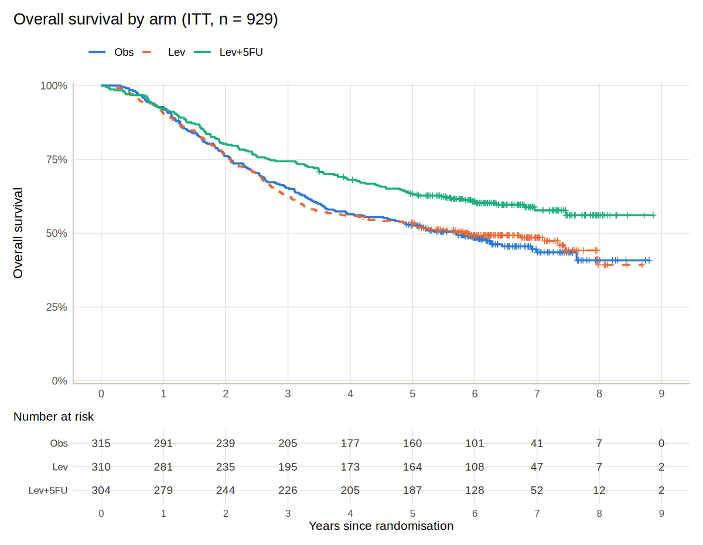
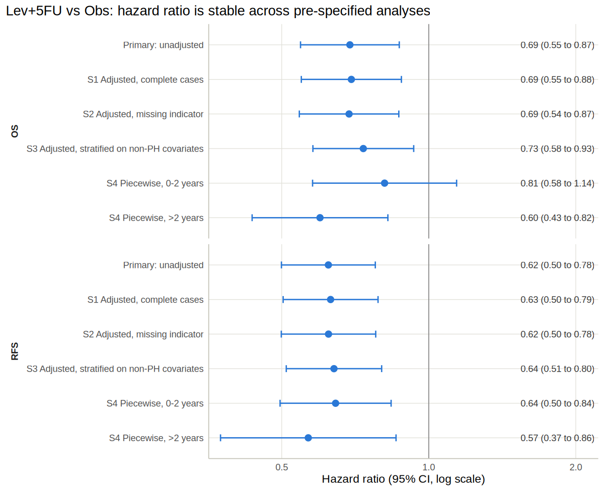
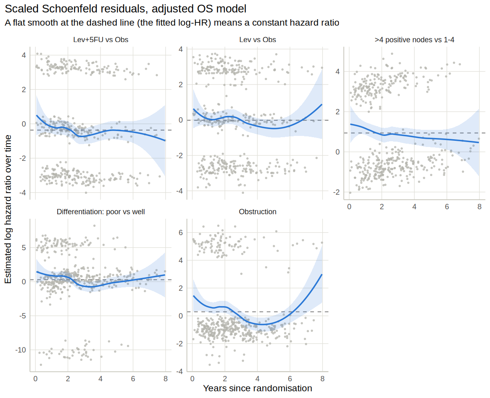

# Clinical Trial Survival Analysis: Adjuvant Chemotherapy in Colon Cancer

[](https://github.com/lukahere007/clinical-trial-survival-analysis/actions/workflows/ci.yml)

[](LICENSE)

**Does adjuvant levamisole + 5-fluorouracil improve survival after resection of stage III colon cancer, compared with observation alone?**

This is a reanalysis of a landmark randomised trial (929 patients, three arms: observation, levamisole, levamisole + 5-FU), written like a small clinical study report. The analysis follows a [statistical analysis plan](SAP.md) that fixes the endpoints, estimands, testing order and sensitivity analyses before any results were looked at in this repository.

## Answer

**Yes for the combination, no for levamisole alone.** All four confirmatory hypotheses were tested in a fixed sequence at two-sided α = 0.05.

| | Lev+5FU vs Obs | Lev vs Obs |
|---|---|---|
| **Overall survival HR** (95% CI) | **0.69 (0.55 to 0.87)**, log-rank p = 0.002 | 0.97 (0.78 to 1.21), p = 0.81 |
| **Recurrence-free survival HR** | **0.62 (0.50 to 0.78)**, p < 0.001 | 0.97 (0.79 to 1.19), descriptive only |
| **5-year RMST gain, OS** | **+3.7 months** (0.6 to 6.7), p = 0.018 | −0.5 months (−3.6 to 2.6) |
| **5-year RMST gain, RFS** | **+7.5 months** (3.9 to 11.2), p < 0.001 | 0.0 months (−3.7 to 3.8) |
| **5-year overall survival** (Kaplan–Meier) | 63.4% vs 52.6% | 53.5% vs 52.6% |

- **Lev+5FU cut the hazard of death by about 31%.** Over the first 5 years, patients assigned to it lived 3.7 months longer on average and spent 7.5 more months free of recurrence.
- **Levamisole alone did nothing measurable.** H3 was not rejected, so the testing sequence stopped there and H4 is reported descriptively.
- **The result is robust.** The Lev+5FU HR stays between 0.69 and 0.73 (OS) across covariate adjustment, missing-data handling and stratification on covariates that break proportional hazards.
- **Proportional hazards hold for treatment** (Schoenfeld test p = 0.48 for OS) but **not for several prognostic covariates** (nodes, differentiation, obstruction), whose effects are strongest in the first two years. These were handled by stratification, as the SAP specified.







The full report, with Table 1, recurrence-free survival curves, RMST tables, PH tests and a competing-risks analysis, is in **[analysis/colon_trial_report.md](analysis/colon_trial_report.md)**.

## What this project demonstrates

| | |
|---|---|
| **SAP-driven analysis** | Objectives, estimands (ICH E9(R1) language), ITT population, a fixed-sequence multiplicity strategy and five sensitivity analyses written down in [SAP.md](SAP.md) first, then followed. |
| **Standard trial outputs** | Table 1 by arm, Kaplan–Meier curves with numbers at risk, medians and 5-year rates with CIs, log-rank tests, unadjusted and adjusted Cox models, forest plots. |
| **Checking the model, not just fitting it** | `cox.zph` tests and Schoenfeld residual plots, with a pre-specified response (stratify a non-PH covariate; fall back on RMST if treatment is non-PH) and a piecewise HR. |
| **An effect measure that does not need PH** | Restricted mean survival time, implemented from scratch in [`R/rmst.R`](R/rmst.R) and unit-tested against both hand calculations and `survival::survfit`. |
| **Missing data and competing risks** | Complete-case vs missing-indicator adjusted models; Aalen–Johansen cumulative incidence of recurrence vs death without recurrence. |
| **Reproducibility** | Tested helper functions, one-command render, CI that runs the tests and re-renders the report. Rendering twice gives byte-identical output. |

## Repository layout

```
├── SAP.md                          # statistical analysis plan (read this first)
├── analysis/
│   ├── colon_trial_report.Rmd      # the analysis
│   └── colon_trial_report.md       # rendered report (GitHub displays this)
├── figures/                        # generated by the report
├── R/
│   ├── data_prep.R                 # two rows per patient -> one row with OS, RFS, TTR
│   ├── rmst.R                      # Kaplan-Meier RMST, SE and between-arm difference
│   └── reporting.R                 # Table 1, KM plot with risk table, forest plot
├── tests/testthat/                 # unit tests for the helpers
└── .github/workflows/ci.yml        # runs tests + renders the report on every push
```

## Reproduce

Requires R ≥ 4.3 and pandoc (bundled with RStudio). The data ship with the `survival` package, so nothing needs downloading.

```bash
git clone https://github.com/lukahere007/clinical-trial-survival-analysis.git
cd clinical-trial-survival-analysis

Rscript -e 'install.packages(c("survival", "ggplot2", "patchwork", "broom", "knitr", "rmarkdown", "testthat"))'

Rscript -e 'testthat::test_dir("tests/testthat")'                  # unit tests
Rscript -e 'rmarkdown::render("analysis/colon_trial_report.Rmd")'  # report + figures
```

The committed results were produced with R 4.3.3, survival 3.5-8, ggplot2 3.4.4, patchwork 1.2.0, broom 1.0.5, knitr 1.45 and rmarkdown 2.25.

## Limitations

- **"Pre-specified" has limits here.** The SAP was written before running any analysis in this repository, but the data are public and the trial's conclusions have been known since 1990. It shows how a pre-specified analysis is structured and followed. It is not evidence that the analyst was blind to the results.
- **This is not the official dataset or analysis.** The `survival::colon` data are close to the final report but not guaranteed identical, and the original investigators' analysis plan was their own, not this one. The estimates agree *qualitatively* with the published reports (benefit for Lev+5FU, none for Lev alone). I have not compared them number-for-number, so treat these figures as from this reanalysis only.
- **No safety, dose or adherence data.** The analysis is ITT efficacy only. A real CSR would weigh the survival benefit against 5-FU toxicity.
- **Data quality issues are reported, not fixed.** Twelve patients have a node count that disagrees with the `node4` flag. The `survival` documentation notes this, and it is unclear which is correct. The SAP uses `node4` and states why.
- **The piecewise and competing-risks analyses are descriptive.** The trial was not powered to show that the treatment effect changes over time.

## Data and references

- Data: `colon` dataset in the R package [`survival`](https://cran.r-project.org/package=survival) (Therneau T).
- Moertel CG, Fleming TR, Macdonald JS, et al. Levamisole and fluorouracil for adjuvant therapy of resected colon carcinoma. *N Engl J Med*. 1990;322(6):352–358.
- Moertel CG, Fleming TR, Macdonald JS, et al. Fluorouracil plus levamisole as effective adjuvant therapy after resection of stage III colon carcinoma: a final report. *Ann Intern Med*. 1995;122(5):321–326.

## License

[MIT](LICENSE).
