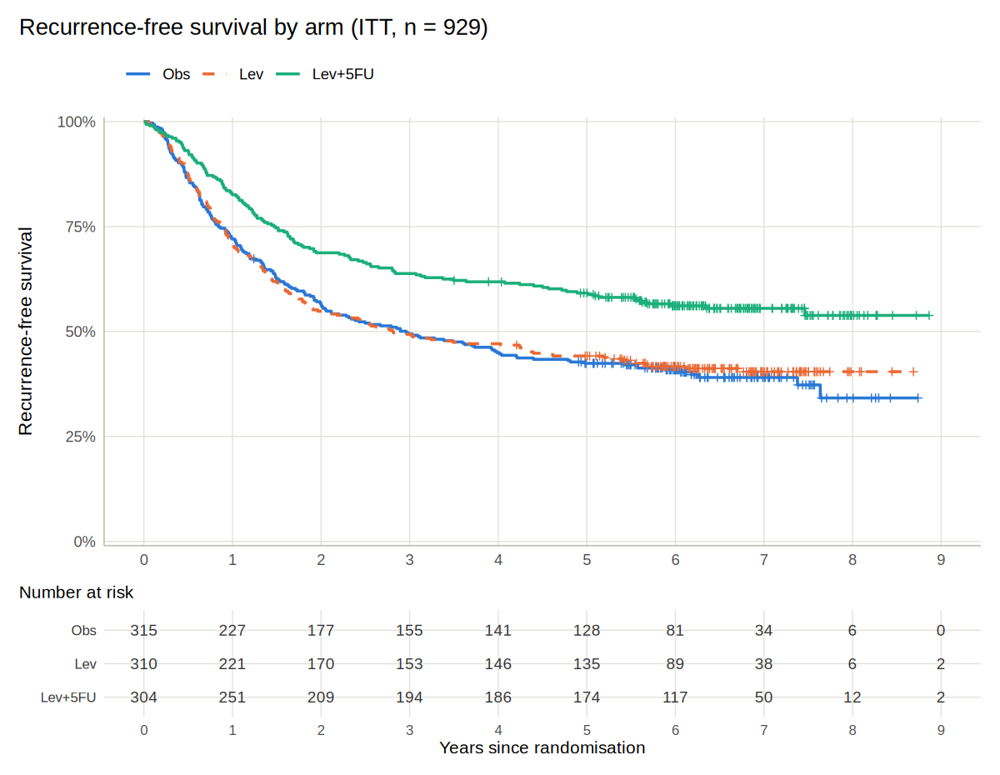
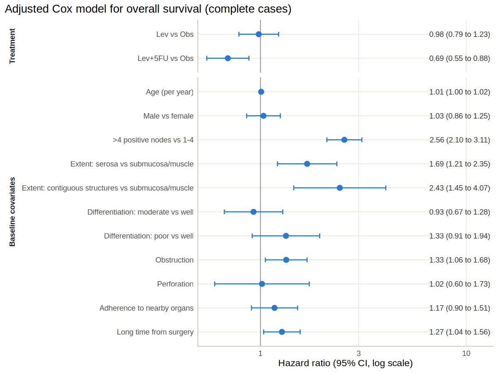
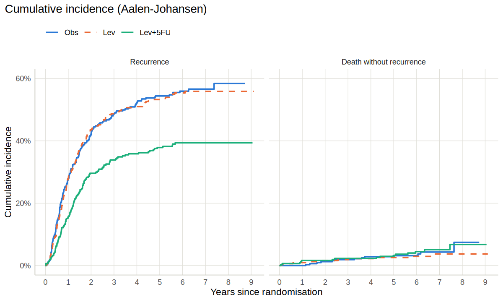

Adjuvant levamisole and 5-FU in stage III colon cancer: survival
reanalysis
================
Luke Wamalwa

This report follows the pre-specified [statistical analysis
plan](../SAP.md). Code for every number is in this R Markdown file and
in [`R/`](../R). Section numbers in brackets (e.g. *SAP 6.4*) point to
the plan.

## 1. Data

`survival::colon` holds the patient-level data from the NCCTG/Intergroup
trial of adjuvant therapy after resection of colon cancer (Moertel et
al., *N Engl J Med* 1990; final report *Ann Intern Med* 1995). Patients
were randomised to observation (Obs), levamisole alone (Lev) or
levamisole + 5-fluorouracil (Lev+5FU). The dataset has two rows per
patient (recurrence and death); `make_analysis_data()` reshapes it to
one row per patient with three endpoints.

| Arm     |   N | Deaths | RFS events | Recurrences | Deaths without recurrence |
|:--------|----:|-------:|-----------:|------------:|--------------------------:|
| Obs     | 315 |    168 |        190 |         177 |                        13 |
| Lev     | 310 |    161 |        182 |         172 |                        10 |
| Lev+5FU | 304 |    123 |        134 |         119 |                        15 |
| Total   | 929 |    452 |        506 |         468 |                        38 |

Patients and events by arm (ITT).

Median follow-up (reverse Kaplan–Meier) is 6.4 years (95% CI 6.3 to
6.6). Shortest follow-up among patients still alive: 1.2 years.

## 2. Baseline characteristics (Table 1)

| Characteristic                    |         Obs |         Lev |     Lev+5FU |       Total |
|:----------------------------------|------------:|------------:|------------:|------------:|
| N                                 |         315 |         310 |         304 |         929 |
| Age, years, median (IQR)          |  60 (53-68) |  61 (53-69) |  62 (52-70) |  61 (53-69) |
| Positive nodes, median (IQR)      |     2 (1-5) |     2 (1-5) |     2 (1-4) |     2 (1-5) |
| Sex                               |             |             |             |             |
|   Female                          | 149 (47.3%) | 133 (42.9%) | 163 (53.6%) | 445 (47.9%) |
|   Male                            | 166 (52.7%) | 177 (57.1%) | 141 (46.4%) | 484 (52.1%) |
| Positive nodes                    |             |             |             |             |
|   1-4                             | 228 (72.4%) | 221 (71.3%) | 225 (74.0%) | 674 (72.6%) |
|   \>4                             |  87 (27.6%) |  89 (28.7%) |  79 (26.0%) | 255 (27.4%) |
| Extent of local spread            |             |             |             |             |
|   Submucosa/muscle                |  46 (14.6%) |  39 (12.6%) |  42 (13.8%) | 127 (13.7%) |
|   Serosa                          | 249 (79.0%) | 259 (83.5%) | 251 (82.6%) | 759 (81.7%) |
|   Contiguous structures           |   20 (6.3%) |   12 (3.9%) |   11 (3.6%) |   43 (4.6%) |
| Differentiation                   |             |             |             |             |
|   Well                            |   27 (8.8%) |  37 (12.3%) |   29 (9.7%) |  93 (10.3%) |
|   Moderate                        | 229 (74.4%) | 219 (73.0%) | 215 (72.1%) | 663 (73.2%) |
|   Poor                            |  52 (16.9%) |  44 (14.7%) |  54 (18.1%) | 150 (16.6%) |
| Obstruction, yes                  |  63 (20.0%) |  63 (20.3%) |  54 (17.8%) | 180 (19.4%) |
| Perforation, yes                  |    9 (2.9%) |   10 (3.2%) |    8 (2.6%) |   27 (2.9%) |
| Adherence to nearby organs, yes   |  47 (14.9%) |  49 (15.8%) |  39 (12.8%) | 135 (14.5%) |
| Time from surgery to registration |             |             |             |             |
|   Short                           | 224 (71.1%) | 230 (74.2%) | 228 (75.0%) | 682 (73.4%) |
|   Long                            |  91 (28.9%) |  80 (25.8%) |  76 (25.0%) | 247 (26.6%) |
| Missing: node count               |           3 |           6 |           9 |          18 |
| Missing: differentiation          |           7 |          10 |           6 |          23 |

Table 1. Baseline characteristics by randomised arm. n (%) of
non-missing, or median (IQR).

The arms are well balanced, as expected after randomisation. No baseline
significance tests are reported (*SAP 6.1*).

### Missing data (*SAP 6.5*)

| Arm     | differ | nodes |
|:--------|-------:|------:|
| Obs     |      7 |     3 |
| Lev     |     10 |     6 |
| Lev+5FU |      6 |     9 |

Missing baseline values by arm (only variables with any missing shown).

Arm and all outcomes are complete. Differentiation is missing for 23
patients, so the adjusted Cox model uses 906 of 929 patients (complete
cases); a missing-indicator analysis (S2) keeps everyone. The raw node
count is missing for 18 patients and disagrees with the `node4` flag for
another 12 (a known inconsistency noted in the `survival`
documentation), which is why the SAP adjusts for `node4` rather than the
count.

## 3. Overall survival (primary endpoint)

<!-- -->

| Arm     |   N | Events | Median, years (95% CI) | 5-year estimate (95% CI) |
|:--------|----:|-------:|:-----------------------|:-------------------------|
| Obs     | 315 |    168 | 5.7 (4.5 to 7.6)       | 52.6% (47.3 to 58.4)     |
| Lev     | 310 |    161 | 5.9 (4.2 to NR)        | 53.5% (48.3 to 59.4)     |
| Lev+5FU | 304 |    123 | Not reached            | 63.4% (58.2 to 69.1)     |

Overall survival: Kaplan-Meier summaries. NR = not reached.

### Hierarchical testing of the confirmatory hypotheses (*SAP 5*)

| Hypothesis | Endpoint | Comparison     | HR (95% CI)         | Log-rank p | Decision                      |
|:-----------|:---------|:---------------|:--------------------|:-----------|:------------------------------|
| H1         | OS       | Lev+5FU vs Obs | 0.69 (0.55 to 0.87) | 0.002      | Rejected                      |
| H2         | RFS      | Lev+5FU vs Obs | 0.62 (0.50 to 0.78) | \<0.001    | Rejected                      |
| H3         | OS       | Lev vs Obs     | 0.97 (0.78 to 1.21) | 0.811      | Not rejected                  |
| H4         | RFS      | Lev vs Obs     | 0.97 (0.79 to 1.19) | 0.756      | Not tested (descriptive only) |

Fixed-sequence testing at two-sided alpha = 0.05. HR from the unadjusted
three-arm Cox model; p from the pairwise log-rank test.

- **H1 (OS, Lev+5FU vs Obs):** HR 0.69 (0.55 to 0.87), log-rank p =
  0.002. Assignment to Lev+5FU reduced the hazard of death by about 31%
  relative to observation.
- The three-arm log-rank test gives χ² = 11.7 on 2 df (p = 0.003); it is
  shown for completeness and is not part of the testing hierarchy.

## 4. Recurrence-free survival (key secondary)

<!-- -->

| Arm     |   N | Events | Median, years (95% CI) | 5-year estimate (95% CI) |
|:--------|----:|-------:|:-----------------------|:-------------------------|
| Obs     | 315 |    190 | 3.0 (2.0 to 4.2)       | 42.4% (37.3 to 48.3)     |
| Lev     | 310 |    182 | 2.8 (1.9 to 5.2)       | 44.2% (39.0 to 50.1)     |
| Lev+5FU | 304 |    134 | Not reached            | 59.2% (53.9 to 65.0)     |

Recurrence-free survival: Kaplan-Meier summaries.

The Lev+5FU curve separates from the other two within the first year and
the gap is built up mainly over the first two to three years, when most
recurrences occur; after that the curves run roughly parallel. For
overall survival the separation starts later (around 1.5 to 2 years), as
expected when deaths follow recurrences.

## 5. Restricted mean survival time (*SAP 6.3*)

The RMST is the area under the Kaplan–Meier curve up to τ. The
difference between arms is the average event-free time gained in the
first τ years. Unlike the HR it does not need proportional hazards, and
it is in units a clinician can use.

| tau (years) | Endpoint | Comparison     | RMST Obs (y) | RMST comparator (y) | Difference, months (95% CI) | p       |
|------------:|:---------|:---------------|:-------------|:--------------------|:----------------------------|:--------|
|           5 | OS       | Lev+5FU vs Obs | 3.67         | 3.97                | 3.7 (0.6 to 6.7)            | 0.018   |
|           5 | OS       | Lev vs Obs     | 3.67         | 3.62                | -0.5 (-3.6 to 2.6)          | 0.736   |
|           5 | RFS      | Lev+5FU vs Obs | 2.94         | 3.56                | 7.5 (3.9 to 11.2)           | \<0.001 |
|           5 | RFS      | Lev vs Obs     | 2.94         | 2.94                | 0.0 (-3.7 to 3.8)           | 0.983   |
|           7 | OS       | Lev+5FU vs Obs | 4.63         | 5.19                | 6.7 (2.0 to 11.3)           | 0.005   |
|           7 | OS       | Lev vs Obs     | 4.63         | 4.62                | -0.1 (-4.9 to 4.6)          | 0.960   |
|           7 | RFS      | Lev+5FU vs Obs | 3.75         | 4.70                | 11.4 (6.0 to 16.7)          | \<0.001 |
|           7 | RFS      | Lev vs Obs     | 3.75         | 3.78                | 0.4 (-5.1 to 5.8)           | 0.895   |

RMST by arm and difference vs observation. tau = 5 years is
pre-specified; tau = 7 years is sensitivity analysis S5.

Over the first 5 years, patients assigned to Lev+5FU lived on average
3.7 months longer (95% CI 0.6 to 6.7) and spent 7.5 more months
recurrence-free (95% CI 3.9 to 11.2) than patients under observation.
Note that a 5-year RMST cannot exceed 60 months, so a few months is a
meaningful gain at the population level.

## 6. Adjusted Cox models and sensitivity analyses

The adjusted OS model (complete cases, n = 906, 441 deaths):

<!-- -->

### Proportional-hazards checks (*SAP 6.4*)

| Endpoint | Model      | Term     | Chi-sq |  df | p       |
|:---------|:-----------|:---------|:-------|----:|:--------|
| OS       | Unadjusted | arm      | 1.48   |   2 | 0.477   |
| OS       | Unadjusted | GLOBAL   | 1.48   |   2 | 0.477   |
| RFS      | Unadjusted | arm      | 0.76   |   2 | 0.685   |
| RFS      | Unadjusted | GLOBAL   | 0.76   |   2 | 0.685   |
| OS       | Adjusted   | arm      | 2.48   |   2 | 0.290   |
| OS       | Adjusted   | age      | 0.88   |   1 | 0.349   |
| OS       | Adjusted   | sex      | 0.40   |   1 | 0.528   |
| OS       | Adjusted   | node4    | 5.77   |   1 | 0.016   |
| OS       | Adjusted   | extent   | 5.78   |   2 | 0.056   |
| OS       | Adjusted   | differ   | 16.79  |   2 | \<0.001 |
| OS       | Adjusted   | obstruct | 6.24   |   1 | 0.013   |
| OS       | Adjusted   | perfor   | 0.74   |   1 | 0.389   |
| OS       | Adjusted   | adhere   | 0.09   |   1 | 0.762   |
| OS       | Adjusted   | surg     | 0.01   |   1 | 0.906   |
| OS       | Adjusted   | GLOBAL   | 39.08  |  13 | \<0.001 |
| RFS      | Adjusted   | arm      | 0.70   |   2 | 0.703   |
| RFS      | Adjusted   | age      | 0.89   |   1 | 0.345   |
| RFS      | Adjusted   | sex      | 2.89   |   1 | 0.089   |
| RFS      | Adjusted   | node4    | 8.01   |   1 | 0.005   |
| RFS      | Adjusted   | extent   | 0.43   |   2 | 0.805   |
| RFS      | Adjusted   | differ   | 24.24  |   2 | \<0.001 |
| RFS      | Adjusted   | obstruct | 6.69   |   1 | 0.010   |
| RFS      | Adjusted   | perfor   | 0.01   |   1 | 0.934   |
| RFS      | Adjusted   | adhere   | 1.19   |   1 | 0.276   |
| RFS      | Adjusted   | surg     | 0.42   |   1 | 0.517   |
| RFS      | Adjusted   | GLOBAL   | 46.50  |  13 | \<0.001 |

Grambsch-Therneau tests on scaled Schoenfeld residuals (cox.zph, KM time
transform).

<!-- -->

**Reading the diagnostics.**

- **Treatment:** no evidence against proportional hazards (unadjusted
  model: OS p = 0.477, RFS p = 0.685). The Lev+5FU smooth drifts from
  slightly above its fitted log-HR in the first year to slightly below
  it around year 3, which matches the OS curves separating only after
  about 1.5 years, but the test is not significant (adjusted OS model: p
  = 0.290). The HR is a reasonable single summary; the RMST difference
  (Section 5) and the piecewise HRs (S4) are reported alongside it so
  the conclusion does not rest on the PH assumption.
- **Covariates:** node4, differ, obstruct (OS) and node4, differ,
  obstruct (RFS) have p \< 0.05. Their residual smooths sit above the
  fitted log-HR in roughly the first two years and below it afterwards:
  the prognostic effect of many positive nodes, poor differentiation and
  obstruction is strongest early. The late upturns for differentiation
  and obstruction rest on few events and wide bands. As pre-specified,
  the adjusted models are refitted **stratified** on these covariates
  (S3), which removes the PH assumption for them while still estimating
  a treatment HR.

| Endpoint | Comparison     | Analysis                                     |   n | Events | HR (95% CI)         | Wald p  |
|:---------|:---------------|:---------------------------------------------|----:|-------:|:--------------------|:--------|
| OS       | Lev vs Obs     | Primary: unadjusted                          | 929 |    452 | 0.97 (0.78 to 1.21) | 0.809   |
| OS       | Lev+5FU vs Obs | Primary: unadjusted                          | 929 |    452 | 0.69 (0.55 to 0.87) | 0.002   |
| OS       | Lev vs Obs     | S1 Adjusted, complete cases                  | 906 |    441 | 0.98 (0.79 to 1.23) | 0.866   |
| OS       | Lev+5FU vs Obs | S1 Adjusted, complete cases                  | 906 |    441 | 0.69 (0.55 to 0.88) | 0.002   |
| OS       | Lev vs Obs     | S2 Adjusted, missing indicator               | 929 |    452 | 0.98 (0.79 to 1.22) | 0.879   |
| OS       | Lev+5FU vs Obs | S2 Adjusted, missing indicator               | 929 |    452 | 0.69 (0.54 to 0.87) | 0.002   |
| OS       | Lev vs Obs     | S3 Adjusted, stratified on non-PH covariates | 906 |    441 | 1.00 (0.80 to 1.25) | 0.981   |
| OS       | Lev+5FU vs Obs | S3 Adjusted, stratified on non-PH covariates | 906 |    441 | 0.73 (0.58 to 0.93) | 0.011   |
| OS       | Lev vs Obs     | S4 Piecewise, 0-2 years                      | 929 |    452 | 1.02 (0.74 to 1.40) | 0.914   |
| OS       | Lev vs Obs     | S4 Piecewise, \>2 years                      | 929 |    452 | 0.94 (0.70 to 1.26) | 0.669   |
| OS       | Lev+5FU vs Obs | S4 Piecewise, 0-2 years                      | 929 |    452 | 0.81 (0.58 to 1.14) | 0.229   |
| OS       | Lev+5FU vs Obs | S4 Piecewise, \>2 years                      | 929 |    452 | 0.60 (0.43 to 0.82) | 0.002   |
| RFS      | Lev vs Obs     | Primary: unadjusted                          | 929 |    506 | 0.97 (0.79 to 1.19) | 0.757   |
| RFS      | Lev+5FU vs Obs | Primary: unadjusted                          | 929 |    506 | 0.62 (0.50 to 0.78) | \<0.001 |
| RFS      | Lev vs Obs     | S1 Adjusted, complete cases                  | 906 |    495 | 0.98 (0.79 to 1.21) | 0.842   |
| RFS      | Lev+5FU vs Obs | S1 Adjusted, complete cases                  | 906 |    495 | 0.63 (0.50 to 0.79) | \<0.001 |
| RFS      | Lev vs Obs     | S2 Adjusted, missing indicator               | 929 |    506 | 0.99 (0.80 to 1.21) | 0.894   |
| RFS      | Lev+5FU vs Obs | S2 Adjusted, missing indicator               | 929 |    506 | 0.62 (0.50 to 0.78) | \<0.001 |
| RFS      | Lev vs Obs     | S3 Adjusted, stratified on non-PH covariates | 906 |    495 | 0.97 (0.78 to 1.19) | 0.755   |
| RFS      | Lev+5FU vs Obs | S3 Adjusted, stratified on non-PH covariates | 906 |    495 | 0.64 (0.51 to 0.80) | \<0.001 |
| RFS      | Lev vs Obs     | S4 Piecewise, 0-2 years                      | 929 |    506 | 1.04 (0.82 to 1.32) | 0.735   |
| RFS      | Lev vs Obs     | S4 Piecewise, \>2 years                      | 929 |    506 | 0.78 (0.52 to 1.17) | 0.235   |
| RFS      | Lev+5FU vs Obs | S4 Piecewise, 0-2 years                      | 929 |    506 | 0.64 (0.50 to 0.84) | 0.001   |
| RFS      | Lev+5FU vs Obs | S4 Piecewise, \>2 years                      | 929 |    506 | 0.57 (0.37 to 0.86) | 0.007   |

Treatment hazard ratios across the primary and sensitivity analyses. For
S4, events counts all events in the model.

<!-- -->

Across the unadjusted and adjusted analyses (S1–S3) the Lev+5FU vs Obs
HR ranges from 0.69 to 0.73 for OS and 0.62 to 0.64 for RFS. The
piecewise estimates (S4) are OS 0.81 (0.58 to 1.14) in years 0–2 and
0.60 (0.43 to 0.82) after 2 years; RFS 0.64 (0.50 to 0.84) and 0.57
(0.37 to 0.86). The confidence intervals of the two periods overlap
widely, so these do not show that the effect changes over time; the
study was not designed to detect that.

## 7. Recurrence with death as a competing risk (*SAP 6.6*)

<!-- -->

| Arm     | Recurrence by 5 years (95% CI) | Death without recurrence by 5 years (95% CI) |
|:--------|:-------------------------------|:---------------------------------------------|
| Obs     | 54.4% (49.2 to 60.2)           | 3.2% (1.7 to 5.9)                            |
| Lev     | 53.2% (48.0 to 59.1)           | 2.6% (1.3 to 5.1)                            |
| Lev+5FU | 37.9% (32.8 to 43.7)           | 3.0% (1.6 to 5.7)                            |

Aalen-Johansen cumulative incidence at 5 years.

Deaths without prior recurrence are uncommon (38 of 929 patients) and
similar across arms, so competing risks barely change the picture here.
The cause-specific HR for recurrence, Lev+5FU vs Obs, is 0.60 (0.47 to
0.76) (p \< 0.001). This is a hazard ratio among patients still alive
and recurrence-free; it is not a ratio of cumulative incidences.

## 8. Conclusions

1.  **Primary (H1).** Assignment to Lev+5FU improved overall survival
    compared with observation: HR 0.69 (0.55 to 0.87), log-rank p =
    0.002, and 3.7 months more life on average over the first 5 years.
2.  **Key secondary (H2).** Recurrence-free survival was also improved
    (HR 0.62 (0.50 to 0.78), log-rank p \< 0.001).
3.  **Levamisole alone (H3).** No evidence that levamisole alone
    improves overall survival (HR 0.97 (0.78 to 1.21), log-rank p =
    0.811). The testing sequence stops here, so H4 is descriptive only.
4.  **Robustness.** The Lev+5FU effect is stable under covariate
    adjustment, missing-data handling and stratification on covariates
    that violate proportional hazards, and the treatment effect itself
    shows no evidence of non-proportional hazards.

These conclusions agree qualitatively with the published trial reports,
which found a benefit of levamisole plus fluorouracil and no clear
benefit of levamisole alone. The numbers here are from the version of
the data in the `survival` package and are not meant to reproduce the
published tables exactly.

Session info

    ## R version 4.3.3 (2024-02-29)

    ## survival 3.5.8
    ## ggplot2 3.4.4
    ## patchwork 1.2.0
    ## broom 1.0.5
    ## knitr 1.45
    ## rmarkdown 2.25

